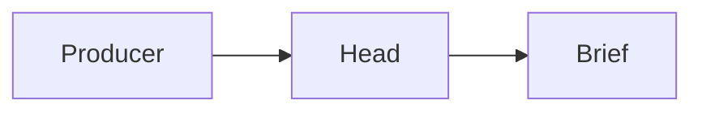

# Deploying the head

Two ways to run this head for real:

- **Vercel with Neon Postgres.** One Vercel project. The draw route is its own function, carrying Chromium.
- **Self-hosted with Docker.** One image with Chromium installed, and Postgres beside it in `docker-compose.yml`. CI runs the conformance gate in this same image.

Either way you end up with a head at an https origin, its owner's passkey registered, and a producer token that `pbcp submit` can use.

What the head needs from its environment is listed, with comments, in [`.env.example`](../.env.example).

## Vercel and Neon

### 1. Create the project

1. Import `morkeleb/pbcp-head`, or your fork, as a new Vercel project.
   - Vercel detects Next.js, and pnpm from `packageManager`.
   - Vercel clones the `vendor/pbcp` submodule because it is public. The install step builds it (`prepare`).
   - No build or install command needs changing.
2. Under **Settings → Build and Deployment**, set **Node.js Version** to 22.x or 24.x. `@sparticuz/chromium` needs Node 22.17 or later.
3. Leave **Fluid compute** on, which is the default.

### 2. Add Postgres

Under **Storage**, add **Neon** from the Marketplace and connect it to the project for every environment. The integration sets these variables, among others:

| Variable | What it is | Used by |
| --- | --- | --- |
| `DATABASE_URL` | Neon's **pooled** URL (the host contains `-pooler`) | the app, at runtime |
| `DATABASE_URL_UNPOOLED` | Neon's **direct** URL | `pnpm db:migrate` |

The app connects through the pooler without prepared statements, so a transaction-mode pooler works. Migrations take the direct URL because they run in one long session.

Neon's connection strings carry `sslmode=require&channel_binding=require`. `db/url.ts` adjusts them for postgres.js:
- `channel_binding` is dropped: postgres.js does not support it and the server would refuse it as a startup parameter.
- `sslmode=require` becomes `verify-full` for `*.neon.tech`, so Neon's certificate is checked.

To give each preview deployment its own database branch instead of the production one, turn on preview branching in the Neon integration.

**Region.** The database is in Neon's `us-east-1` (AWS, N. Virginia), so `vercel.json` pins functions to `iad1`, the Vercel region beside it: `"regions": ["iad1"]`. Every route makes several queries in a transaction, and each one would otherwise cross the Atlantic from a European region. If you move the database, move the region with it. Pinning a region in `vercel.json` overrides **Settings → Functions → Function Region**.

### 3. Set the environment variables

Under **Settings → Environment Variables**, for Production (and Preview, with different values if you like):

| Variable | Value |
| --- | --- |
| `SESSION_SECRET` | `openssl rand -base64 48`; at least 32 characters |
| `CRON_SECRET` | `openssl rand -base64 32`. Vercel Cron sends it to `/api/cron/brief` as a bearer token by itself |
| `WEBAUTHN_ORIGIN` | `https://<your domain>`, the origin passkeys are registered for. **Required:** it is also the OAuth issuer and the MCP resource, which are never taken from a request's Host header, so the head refuses to start without it |
| `WEBAUTHN_RP_ID` | optional; defaults to the host of `WEBAUTHN_ORIGIN` |
| `VAPID_PUBLIC_KEY`, `VAPID_PRIVATE_KEY` | optional; the Web Push key pair for the daily brief notification. Generate it with `npx web-push generate-vapid-keys` (it prints both, base64url). Without them, Settings says notifications are unavailable. Keep the pair: a new one invalidates every device's subscription, and each device then has to turn its notification on again |
| `VAPID_SUBJECT` | optional; a `mailto:` or `https:` contact the push services may use. Defaults to `WEBAUTHN_ORIGIN` |
| `APPLE_CLIENT_ID` | optional; Sign in with Apple's Services ID and/or bundle id |
| `PBCP_HEAD` | optional; which head `GET /` describes when the database holds more than one |
| `NODE_OPTIONS` | `--experimental-require-module`, for Production and Preview. **Required** |

Why `NODE_OPTIONS` is required:
- **Vercel's runtime switches it off.** Functions run on AWS Lambda's Node runtime, which starts Node with `--no-experimental-require-module` unless `NODE_OPTIONS` contains `--experimental-require-module`.
- **The renderer needs it.** It uses jsdom, and jsdom's dependencies are CommonJS modules that `require()` ES modules (`@exodus/bytes`, `@csstools/*`).
- **Without it, every `/api/me` route fails** with a bodyless 500 and `ERR_REQUIRE_ESM` in the function log.
- **Locally nothing shows.** Node 22.12 and later allow it by default, as does the Docker image, so local runs and tests pass either way.

Do not set the following:

- **`PBCP_TEST_MODE`.** A production deployment refuses to build or start while it is set (`lib/boot.ts`).
- **`PBCP_CHROMIUM_PATH`.** On Vercel the head uses `@sparticuz/chromium` by itself. If you set it, set it to `@sparticuz/chromium`.
- **`PBCP_DRAW_URL`.** The head finds its own draw route (below).

Passkeys are bound to the RP id, so settle on the domain before the owner enrols. Moving to another domain later means registering passkeys again.

### 4. Functions: the draw route and the cron

`vercel.json` configures two functions:

- **`/api/render/draw`**: 2048 MB, `maxDuration` 60 s. This is the only function that loads Chromium. The rest of the head sends each mermaid fence there over HTTPS (`lib/render/drawer.ts`), authenticated with a key derived from `SESSION_SECRET`.
- **`/api/cron/brief`**: `maxDuration` 300 s. It mints the nightly `head:daily` card and sends the daily notifications.

How the head finds its draw route:

- A production deployment calls its production domain (`VERCEL_PROJECT_PRODUCTION_URL`), which Deployment Protection does not cover.
- A preview deployment calls its own URL (`VERCEL_URL`). Under Deployment Protection that needs **Settings → Deployment Protection → Protection Bypass for Automation**. Vercel then exposes `VERCEL_AUTOMATION_BYPASS_SECRET` to the functions, and the head sends it along. Without it, preview deployments store cards but leave diagrams undrawn; they are drawn on a later read once the route is reachable.

With Fluid compute, Vercel may take a function's memory from the project's **Function CPU** setting rather than from `vercel.json`. The Standard size (1 vCPU, 2 GB) is what the draw route needs; do not go below it.

Build on Vercel, not locally. The serverless Chromium in `@sparticuz/chromium` is x86_64 only, and a `vercel build` on an arm64 machine (an Apple Silicon Mac) marks every function arm64. `vercel deploy --prebuilt` from such a machine would therefore ship a draw function that cannot start its browser. Vercel's own builders are x86_64.

#### The nightly brief, the daily notification, and Hobby versus Pro

`vercel.json` runs `/api/cron/brief` every 15 minutes (`*/15 * * * *`), which a Pro plan allows (Pro runs cron jobs as often as once a minute). It was hourly at half past; the daily notification's times are quarter hours, so the schedule is every quarter hour. Each run checks every head: once it is 05:30 or later in the head's **effective timezone**, and that local date has no `head:daily:<date>` card yet, it mints one. The effective timezone is:

1. the owner's override, set with `PATCH /api/me/settings { "timezone": "Europe/Copenhagen" }` (or `pnpm seed --timezone`), when set;
2. otherwise the zone of the owner's device most recently seen: every `/api/me` request may send `X-Timezone`, and the web app always does;
3. otherwise UTC.

So the card follows the owner when they travel.
- **Never doubled.** The card's id is the local date, and a date that already has its card is skipped, so a zone change mid-day doesn't mint the day twice.
- **Not skipped once reached.** A date gets its card at the first run after its 05:30 in the zone the owner is in.
- **Some dates never happen.** A flight east across midnight can skip over a date's 05:30 altogether, and that date then has no card.
- **On time.** Running every quarter hour, the card lands at 05:30 in whole- and half-hour zones and 05:45 in Nepal.

**The daily notification** (Settings → Devices, per device): each run sends one push to every device whose chosen time, a quarter hour in that device's timezone, came since the previous run. The run is recorded in `cron_runs`. A device gets one a day at most: its `last_notified_on` is claimed before sending, so a repeated or overlapping run never sends twice. A missed run is caught up by the next, as long as it is the same local day. The notification quotes the first sentence of the day's paragraph once the card exists; otherwise it says how many decisions wait.

**Urgent cards** (Settings → Devices, per device, off by default) need no cron. A card stored with `delivery: immediate` (its urgency after the producer's and its labels' ceilings, §9) is pushed from its PUT request after the commit, to each device with the switch on. The push carries its title, its lead cut at 120 characters, and a tap opens the card. It is best effort: a failed push never fails the PUT, and it is not retried.

**Hobby allows only daily cron jobs.** An hourly or quarter-hourly expression fails the deployment with "Hobby accounts are limited to daily cron jobs". On Hobby, change the schedule to one daily run that lands after 05:30 local all year (Europe/Copenhagen: `0 5 * * *`). That brings two limits:
- the card for a travelling owner comes at whatever local hour that run falls on;
- Hobby fires a daily job anywhere within its hour.

Hobby allows 100 cron jobs per project, so 24 daily entries (`30 0 * * *` … `30 23 * * *`, each with a distinct path such as `/api/cron/brief?h=0`) give hourly coverage within its rules. A missed or extra run is harmless either way. A notification then comes at the first run after its time, so on such a schedule a 07:15 notification arrives at about 07:30.

### 5. Migrate and seed

Neon's variables are **sensitive**: Vercel hands them to builds and functions, but `vercel env pull` writes them empty. The simplest way to migrate is therefore during the production build. Set **Settings → Build and Deployment → Build Command** to:

```sh
if [ "$VERCEL_ENV" = "production" ]; then pnpm db:migrate && pnpm seed morten --name "Morten" --if-new > /dev/null; fi && pnpm build
```

- **Production builds** migrate with `DATABASE_URL_UNPOOLED`, create the head if it does not exist yet, then build.
- **Preview builds** only build, so they never migrate the production database.
- **The seed's output is discarded,** so no enrolment link ends up in the build log.

The enrolment link is signed with `SESSION_SECRET`, so to make one you need that value on your machine. Keep a copy when you create it.

- **The file to keep it in.** Put that copy, and any other value you need locally, in a gitignored file that Next.js does not load, such as `.env.vercel-production`.
- **Never `.env.production`.** Next.js reads a file with that name in every local `next build` and `next start`. A production `DATABASE_URL` in it reaches every local run, and an empty `VERCEL_GIT_COMMIT_SHA` from `vercel env pull` used to empty the build id.

```sh
vercel link
vercel env pull .env.vercel-production --environment=production   # sensitive values come back empty
# add SESSION_SECRET (your copy), and for scripts that need the database, DATABASE_URL: Storage → the
# Neon database → .env.local → Show secret. Use the unpooled URL; a one-off script needs no pooler.
set -a; . ./.env.vercel-production; set +a

pnpm enroll morten                                  # prints the enrolment link
```

`pnpm enroll` prints a link to `WEBAUTHN_ORIGIN/signin?enroll=…`, valid for one hour.
- Open it in the browser that should hold the owner's passkey and register. In Safari the passkey goes to iCloud Keychain and syncs to the owner's Apple devices.
- Run `pnpm enroll morten` again for a fresh link.

`morten` is the head id: the person id producers address as `to_person`. It never changes. `--name` is only how the owner is shown, and can be changed later in `PATCH /api/me/settings`. Without `--timezone` the head follows the zone of the owner's active device (see the nightly brief above); `--timezone` pins it.

With the build command above, every production deployment applies new migrations (`db/migrations`) by itself.

#### Demo data

`pnpm demo morten` fills the head with example cards, shaped as each connector in `morkeleb/pbcp` makes them (caldav, goalpath, hermes, imap, n8n, obsidian-daily, todoist):
- a calendar agenda drawn as a gantt chart, and an event that moved;
- a GoalPath risk superseding an on-track card, an approval, a red build and the daily digest;
- a Hermes reply to approve or edit;
- mail to archive or keep;
- an n8n choice list with a chart;
- a daily note;
- three orders: two done by Hermes and Todoist, one in progress.

It needs `DATABASE_URL` and `SESSION_SECRET` loaded as above.
- **Credentials:** it uses the database only to mint producer tokens and an owner session, and revokes both when it finishes.
- **Cards:** it sends them to the deployment over HTTPS (`--url`, default `WEBAUTHN_ORIGIN`), so the head renders them and draws their diagrams as it would real ones.
- **Removing it:** `pnpm demo morten --remove` deletes every demo card (their ids have the namespace `demo`), the demo orders and their executors' cards.
- **Purging it:** `pnpm demo:purge --head morten [--dry-run]` also deletes the demo's producer tokens, and every card of a demo root (`lib/demo/data.ts`) that no real producer holds, earlier demo runs' included. A root with a live token that isn't the demo's (a real `n8n` or `hermes`) keeps all its cards but the `demo` ones. It refuses to run without `--head`; `--dry-run` lists what it would remove.

### 6. Deploy

Push, or click **Deploy**. Then check:

```sh
curl https://<your domain>/          # {"protocol":"pbcp/1","owner":"morten","seq":0,"extensions":["orders"],…}
```

Sign in at `https://<your domain>/signin` with the enrolled passkey. The brief is at `/brief`.

## Self-hosted with Docker

```sh
git clone --recurse-submodules https://github.com/morkeleb/pbcp-head && cd pbcp-head
cp .env.example .env    # set SESSION_SECRET, CRON_SECRET, WEBAUTHN_ORIGIN and PBCP_OWNER (and PBCP_TIMEZONE)
docker compose up -d
docker compose logs head   # the enrolment link for PBCP_OWNER's first passkey
```

That one `up` does the following:
- builds the image (Debian, Node 22, Chromium);
- starts Postgres 17, with data in the `pgdata` volume;
- migrates the database;
- creates the `PBCP_OWNER` head on first start and prints its enrolment link;
- serves the head on port 3000, or `PBCP_PORT`.

A `cron` service calls the nightly-brief route every 15 minutes with `CRON_SECRET`, standing in for Vercel Cron. For the daily notification, set `VAPID_PUBLIC_KEY` and `VAPID_PRIVATE_KEY` in `.env` too.

- **TLS.** Passkeys need a secure origin, so outside `localhost` put the head behind a TLS-terminating reverse proxy (Caddy, nginx, Traefik). Set `WEBAUTHN_ORIGIN` to its `https://` origin.
- **Client addresses.** The proxy must set `X-Forwarded-For` or `X-Real-IP` to the client address. The per-address rate limit on `/api/auth/*` keys on it, so without a proxy every client shares one limit. Do not expose port 3000 directly.
- **Postgres** is published on `127.0.0.1:5433` (`PBCP_DB_PORT`) only, for backups and development. Back up with `docker compose exec postgres pg_dump -U pbcp pbcp > backup.sql`.
- **Upgrades.** `git pull && docker compose up -d --build`. The entrypoint migrates before starting.
- **Chromium** runs without its own sandbox inside the container (`PBCP_CHROMIUM_NO_SANDBOX=1`), because Docker's default seccomp profile denies the user namespaces it needs. The container is the boundary, and drawing has no network either way (a dead proxy; `lib/render/draw.ts`).

Other commands run inside the container:

```sh
docker compose exec head pnpm seed morten                       # a new enrolment link
docker compose exec head pnpm mint-token morten hermes          # a producer token (below)
docker compose run --rm head pnpm test:gate                     # the test suites and the conformance gate
```

For development, start only the database with `docker compose up -d --wait postgres` and run `pnpm dev`, as in the README.

## The first producer token, and `pbcp submit`

A producer token is bound to one head and one namespace root (RFC §12). It is printed once; the head stores only its sha256.

```sh
# Vercel: with the production environment loaded, as in step 5
pnpm mint-token morten hermes                       # ceiling `brief` (§9), the default for a new producer
pnpm mint-token morten n8n --ceiling immediate      # one allowed to interrupt
pnpm mint-token morten todoist --executor           # a producer that may claim orders (Appendix A)
pnpm revoke-token morten n8n                        # revoke every live token of a root

# Docker
docker compose exec head pnpm mint-token morten hermes
```

A root that already has a live token is refused (409): revoke it first, or pass `--instance <name>` for a second installation of the same connector (§12). The same is on the head's Settings page (`/settings` → Producers), which mints a token, shows it once, and revokes; it and these scripts share `lib/settings/producers.ts`. Ceilings are set there too, or from `PATCH /api/me/producers/{root}`.

The producer routes live under `/api` (`PUT /api/cards/{id}`, `GET /api/changes`, and `GET /api` describes the head). So the head URL a producer uses is the origin plus `/api`.

`@pbcp/cli` is not on npm yet. Build it from the protocol repo:

```sh
git clone https://github.com/morkeleb/pbcp && cd pbcp && pnpm install && pnpm -r --filter @pbcp/cli... build
alias pbcp="node $PWD/packages/cli/dist/src/bin.js"

export PBCP_HEAD_URL=https://<your domain>/api PBCP_TOKEN=pbcp_…
pbcp describe
pbcp submit card.md        # prints { status: 201, card }
pbcp sync                  # the producer's changes, page by page
```

Here is a card to try. Its diagram is drawn by the draw route, and the card shows up in `/brief`:

````markdown
---
protocol: pbcp/1
id: hermes:hello:1
kind: artifact
to_person: morten
producer: hermes
title: Hello from hermes
emitted_at: 2026-10-26T20:00:00Z
---
The head drew this.


````

## Hardening

What is in place before the head is exposed, and where each part is tested:

| | | Tested in |
| --- | --- | --- |
| **Rate limits** | 120 requests/min per producer token on `PUT /api/cards/{id}` and on `GET /api/changes`; 30/min per client address on `/api/auth/*`. Over the limit: `429 rate_limited` with `Retry-After`, after `401` and before `413` as §7.1 orders them. Counted in Postgres (`rate_limits`), so all serverless instances share one count (`lib/rate-limit.ts`). | `test/http/hardening.test.ts` |
| **Body limit** | Any API request declaring a body over 1 MiB gets `413 too_large` before a byte of the body is read. A body sent without a length is cut off as it passes 1 MiB (`lib/http.ts`). Next.js's Proxy (middleware) is deliberately not used for this: Next.js buffers a request body before running a proxy on it. Vercel itself refuses request bodies over 4.5 MB before any function runs. | `test/http/hardening.test.ts` |
| **Page CSP** | A fresh nonce per request (`proxy.ts`). Scripts run only with that nonce, so nothing in rendered card HTML can run (no inline handlers, `javascript:` URLs or injected scripts). Images only from the head itself, i.e. drawn SVG at `/api/me/svg/…` and the image proxy at `/api/me/img`, and `data:` URIs, which §3.1 requires a head to show. Also `object-src`, `frame-src` and `frame-ancestors 'none'`, `base-uri 'none'`, plus `nosniff`, `X-Frame-Options: DENY`, `Referrer-Policy: no-referrer`, COOP and HSTS. | `hardening.test.ts`, `ui.test.ts` (in a browser) |
| **API CSP** | Every `/api` response, including those carrying `rendered_html`, is served with `default-src 'none'; frame-ancestors 'none'; sandbox`. If one is ever opened as a document, no script runs. The image routes send their own image CSP. | `test/http/hardening.test.ts` |
| **Image proxy** | https only, public addresses only (checked at connect time), image content types only (png, jpeg, gif, webp, avif, sanitised svg), at most 2 MB, declared or streamed. | `test/hardening-unit.test.ts` |
| **Test mode** | `PBCP_TEST_MODE` with `VERCEL_ENV=production` fails the build (`next.config.ts`) and the boot (`instrumentation.ts`). | both test files |

## Function sizes and cold start

Measured from a `vercel build` (CLI 50.14.1) in a linux/amd64 container, which is what Vercel's builders are. Each function directory was assembled from the build output as Vercel would upload it. Sizes are uncompressed; Vercel's limit is 250 MB.

| Function | Size | Serves |
| --- | --- | --- |
| `api/render/draw` | 217.3 MB | the draw route only: Chromium 70 MB (brotli), mermaid's ESM build and parser bundle, mermaid-cli's fonts and stylesheets |
| `api/auth/apple` (shared) | 129.4 MB | every other API route; Vercel groups routes with the same settings into one function |
| `api/cron/brief` | 127.9 MB | the nightly brief (its own `maxDuration`) |
| `brief` (shared) | 116.8 MB | the pages |

About 115 MB of every function is the base Vercel's builder traces for any Next.js 16 function, chiefly Next.js's own server runtimes. Excludes in `next.config.ts` cannot reach that part. The draw function's own share is about 100 MB, which leaves it some 30 MB under the limit. A dependency upgrade that grows mermaid, its fonts or Chromium noticeably can cross 250 MB, so check the size after one.

The files mermaid-cli loads at runtime are not visible to file tracing; `next.config.ts` lists them. If a draw on Vercel fails with `ERR_MODULE_NOT_FOUND` or `Failed to fetch dynamically imported module`, a file is missing from that list.

The draw function's cold start was measured by running that directory in the AWS Lambda Node.js image (Amazon Linux 2023, x86_64, 2 GB, 1 CPU) under emulation on an Apple Silicon Mac, so expect a real Vercel cold start to be faster:

| | Time |
| --- | --- |
| Loading the function (Next.js launcher, minimal mode) | 1.2–1.4 s |
| First draw: inflating Chromium into `/tmp`, launching it, loading mermaid, drawing | 8.6–8.9 s |
| Warm draws | 1.1–1.3 s |

The whole test suite, R01–R08 included (225 tests), passes with every diagram drawn by that function.

A cold draw happens only when a new card brings a fence that is not yet in the diagram cache, and a card is rendered after its PUT has been answered (`after()`). A producer never waits for it; at worst the owner sees a card a few seconds before its diagram.

## Using the head from an assistant (MCP)

The head serves the owner's MCP server at `/api/mcp`: tools to read the brief and record decisions (`brief`, `list_cards`, `get_card`, `decide`, `acknowledge`, `snooze`, `unsnooze`, `create_order`). An assistant signs in with OAuth (PKCE, dynamic client registration); the owner allows it with their passkey, and signs it out in Settings → Devices. Nothing to configure on the head: the metadata is at `/.well-known/oauth-authorization-server` and `/.well-known/oauth-protected-resource`.

**The Claude app, as a custom connector**

1. In Claude, open **Settings → Connectors → Add custom connector**.
2. Name it (say, *Brief*) and give the URL `https://<your head>/api/mcp`. Leave the OAuth client fields empty: the head registers the app itself.
3. **Connect**: your head's sign-in page opens; sign in with your passkey and **Allow**. The connector's tools are then available in your chats.

**Claude Desktop, over stdio** (or any MCP client that runs a local command)

```sh
pnpm install && pnpm --filter @pbcp-head/owner-mcp build        # builds packages/owner-mcp/dist/stdio.js
node packages/owner-mcp/dist/stdio.js login https://<your head>  # opens the consent page; prints two lines
```

Put what it prints into `claude_desktop_config.json` (Settings → Developer → Edit Config):

```json
{
  "mcpServers": {
    "brief": {
      "command": "node",
      "args": ["/absolute/path/to/pbcp-head/packages/owner-mcp/dist/stdio.js"],
      "env": { "PBCP_HEAD_URL": "https://<your head>", "PBCP_SESSION": "<what login printed>" }
    }
  }
}
```

`PBCP_SESSION` is an assistant's session (`<client id>:<refresh token>`), never a producer token, which the binary refuses. Refresh tokens rotate; the newest is kept in `~/.config/pbcp-owner-mcp/` and used from then on. Signing the device out in Settings ends it; run `login` again to reconnect. `login` registers its OAuth client once and reuses it from that state file; `login --register <head>` registers a new one. A registered client that never completes a sign-in is deleted after 7 days.
