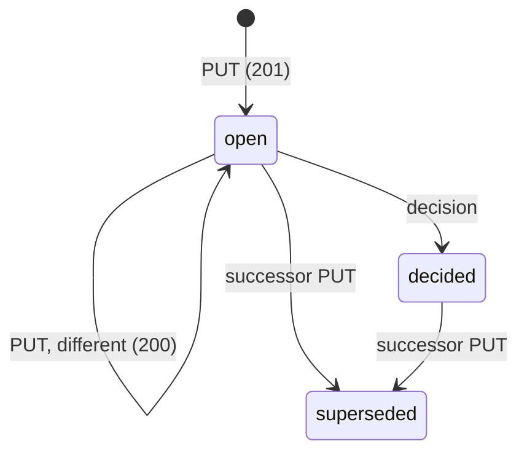

# RFC: Personal Brief Card Protocol

Oct 26, 2026 · @Morten Nielsen · Draft 0.3

## Abstract

This document specifies a protocol for crossing the authority boundary between autonomous software and a person. An agent works on its own until it reaches a decision it is not authorised to make; it then submits a *card* to that person's *head*, the person decides, and the agent continues. Cards from every producer (agents, scripts, mail readers, calendars, project trackers) land in the same head, so the person has one place to review and one record of what they decided. A card is a JSON object with a markdown body, with an equivalent YAML-front-matter file form. It is submitted by HTTP PUT under a producer-minted identifier, which makes submission idempotent by identity. A decided card is immutable.

The core protocol is deliberately small: three operations, one document, one state machine in the core (extensions may add their own lifecycle). A conforming producer can be written in an afternoon with an HTTP client and a string template. It is the mailbox model (SMTP, IMAP) rather than the collaboration model (Google Wave): one writer per card and no concurrent editing. A card may be replaced by its producer while open; once decided it is locked, and change requires a new card. Giving work back to agents — orders, claims, delegation — is specified as an extension (Appendix A) on top of the same card primitive, so a head or producer that only needs the decision flow can ignore it.

**Status:** Draft 0.3, for discussion. The core protocol is implemented as a library, a conformance suite, a client and one producer; no head implements it end to end yet. Draft 0.3 makes normative what that implementation had to decide: the restricted YAML subset, semantic equality, percent-encoded upstream ids, sync and parking rules, refusals and their error codes, and a `GET /` description. `rfc/CHANGELOG.md` lists every change against 0.2.

## 1. Motivation

A person who runs several agents ends up with as many inboxes as agents: each tool reports in its own chat, its own dashboard, its own email. Nothing is triaged across them, nothing is remembered across them, and the person is the only integration point. The head exists to be that integration point instead.

The head is modelled on the brief a secretary gives an executive: a short account of what happened since you last looked, the decisions that need you, and a place to issue orders back. It is a review surface, not a conversation. The person reads, decides, and leaves; the agents continue. The brief is the reference head, not the only possible one — a CLI, a mobile app, a daily email or an Obsidian plugin can all be heads — but the protocol is designed so that the brief, the day view and the decision log are natural to build on it.

A shared contract matters more than any one head implementation. If every agent, mail reader and tracker speaks the same card format, a head is interchangeable and a connector is written once. The design goals, in priority order:

1. **Trivial to produce.** A connector needs an HTTP client and a string template. No SDK, no schema registry, no live connection.
2. **Safe to retry.** Networks fail and loops re-run. Submitting the same card twice must be harmless.
3. **Decisions are final.** Once a person has decided, the record of what they decided on must never change underneath them.
4. **Strictly personal.** A card belongs to one person. Team work belongs in team tools; this protocol only carries what reaches an individual.
5. **Readable without software.** A card is a text file a human can open in an editor.

### 1.1 Non-goals

This protocol does not provide, and should not be extended to provide:

- team collaboration, shared inboxes or multi-party consensus;
- live or concurrent editing of any document;
- task or project management as a system of record;
- general workflow orchestration or event streaming;
- guaranteed or exactly-once execution of external side effects;
- verification of the truth or authority of a card's content;
- agent-to-agent conversation.

The head is authoritative only for what reached the person, what they saw, what they decided and what they ordered. Every producer remains authoritative for its own domain.

### 1.2 A day, end to end

| Time | Producer | What it does | Card |
| --- | --- | --- | --- |
| 06:00 | mail agent | Sees a customer asking for a contract change; drafts a reply | `hermes:gmail:19a4…` decision, brief |
| 06:05 | project tracker | Notices a milestone at risk after overnight commits; asks who should review it | `goalpath:milestone:88:risk` decision, brief |
| 06:10 | calendar | A customer meeting now overlaps the roadmap review | `cal:event:7f3a:conflict` decision, brief |
| 06:30 | head | Writes the morning brief: 2 decisions, 1 warning, 11 log entries folded | `head:daily:2026-10-07` artifact |
| 08:10 | person | Reads the brief. Approves the reply, edits the meeting proposal, delegates the risk review to a colleague | three decisions, three cards locked |
| 08:11 | mail agent | Syncs, sees `approve`, sends the reply, posts a `sent` signal in the thread | `hermes:gmail:19a4…:sent` log |
| 08:11 | calendar | Syncs, sees `edited`, reschedules to the replacement time | — |
| 08:12 | colleague's head | Syncs the delegation, shows it to its owner as a decision card | (Appendix B, not yet specified) |
| 18:00 | head | Day view: every card, every decision, in order | — |

Each producer talked only to the head, only by PUT and sync, and never had to know what the brief looked like or that the other producers existed.

## 2. Terminology and conventions

The key words MUST, MUST NOT, SHOULD, SHOULD NOT and MAY are to be interpreted as described in RFC 2119.

| Term | Meaning |
| --- | --- |
| **Head** | The service that stores cards for one person, renders them, records decisions, and issues orders. |
| **Producer** | Anything that submits cards to a head: an agent, a script, a mail reader, a calendar connector, a project tracker. |
| **Executor** | A producer that also polls for orders and carries them out. Every executor is a producer; not every producer is an executor. |
| **Card** | One unit of content: a YAML header plus a markdown body. The only document in the protocol. |
| **Thread** | A producer-chosen grouping key. Cards sharing a thread are folded together by the head. |
| **Decision** | The person's recorded response to a card. Locks the card. |
| **Order** | A card minted by the head that asks a producer to do something. |
| **Namespace** | The prefix of a card id that a producer owns and may write under. |

Timestamps are RFC 3339 in UTC, written with the offset `Z`, `+00:00` or `-00:00`; a head MUST reject with `400` a card with any other offset, or with a date or time that does not exist (a leap second `:60` is allowed). Identifiers are ASCII, case-sensitive, and compared as exact strings. The canonical wire encoding of a card is `application/json`; the file form is markdown with YAML front matter, and the two MUST be convertible field for field. Equality between cards is semantic, judged on the parsed fields, never on bytes (§5 defines it). Every card carries `protocol: pbcp/1`; the number is the major version, and backward-compatible additions arrive as extension fields without changing it. The value is exactly `pbcp/` followed by the major version: a head MUST reject with `400` a card whose major version it does not implement, a value of any other shape (`pbcp/1.1` included), and a card without `protocol`.

## 3. Card format

A card has two equivalent forms. On the wire it is a JSON object whose `body` member holds the markdown. As a file it is a UTF-8 text document: a YAML header between two `---` lines, followed by the markdown body — the front-matter convention used by Jekyll, Hugo and Obsidian, chosen because it is already familiar, readable in any editor, and can be written with a template. The file form is what a producer stores, logs and debugs; the wire form is what it sends. A head MAY accept the file form on PUT as `text/markdown`, but MUST accept JSON.

```markdown
---
protocol: pbcp/1
id: hermes:gmail:19a4f2e7c3b1
kind: decision
to_person: morten
producer: hermes
thread: gmail:19a4f2e7c3b1
urgency: brief
title: Reply to Anna re invoice timing
actions: [approve, reject, edit]
references: []
emitted_at: "2026-10-07T13:02:11Z"
source:
  url: https://mail.google.com/mail/u/0/#inbox/19a4f2e7c3b1
  label: Gmail thread
---

Anna (Nordic Supply) asks whether the September invoice can be paid on the 20th instead of the 15th. Last three invoices were paid on time; no prior requests.

## Proposed reply

> Hi Anna — the 20th is fine for September. Let's keep the 15th from October on.
>
> Best, Morten
```

The same card on the wire:

```json
{
  "protocol": "pbcp/1",
  "id": "hermes:gmail:19a4f2e7c3b1",
  "kind": "decision",
  "to_person": "morten",
  "producer": "hermes",
  "thread": "gmail:19a4f2e7c3b1",
  "urgency": "brief",
  "title": "Reply to Anna re invoice timing",
  "actions": ["approve", "reject", "edit"],
  "references": [],
  "emitted_at": "2026-10-07T13:02:11Z",
  "source": { "url": "https://mail.google.com/...", "label": "Gmail thread" },
  "body": "Anna (Nordic Supply) asks whether ..."
}
```

**Restricted YAML.** To keep parsers simple and avoid YAML's implicit-typing surprises, the header MUST use only this subset:

- `key: value` pairs at the top level, written as the key, a colon and one space; keys are unquoted, start with a letter, digit or `_`, continue with those and `.` or `-`, and appear at most once;
- scalars that are plain, `'single-quoted'` or `"double-quoted"` (with the JSON escape set), each on one line. A plain scalar does not start with a YAML indicator (`-`, `?`, `:` followed by a space; `,`, `[`, `]`, `{`, `}`, `#`, `&`, `*`, `!`, `|`, `>`, `'`, `"`, `%`, `@`, `` ` ``). Every scalar is parsed as a string, whatever it looks like; the protocol then validates named fields against their types (so YAML → strings → validation → typed JSON). An empty value (`thread:` with nothing after it) is the empty string. Producers SHOULD quote anything a YAML parser might otherwise coerce (`no`, `1.0`, dates) so the file reads the same in any editor;
- flow sequences of scalars (`[a, b]`) on one line, and block sequences (`- a`);
- one level of nested mapping (as in `source` above), whose values are scalars;
- block sequences whose items are one-level mappings of scalars, so that §4.4 choice objects have a file form (below). A boolean in such a mapping is written `"true"` or `"false"` and typed after parsing;
- full-line comments, and trailing comments introduced by a space and `#`. As in YAML, ` #` ends a plain scalar, so `title: Fix #12` reads as `Fix`; a value containing ` #` is quoted.

Nothing else is in the subset. In particular: anchors, aliases, tags, directives (`%YAML`), document markers (`---`, `...`) inside the header, block scalars (`|`, `>`), flow mappings (`{a: b}`), scalars that continue onto a second line, quoted or complex keys, tabs in indentation, duplicate keys, and nesting deeper than shown here. A header that uses anything outside this subset MUST be rejected with `400`.

```markdown
actions:
  - id: ship-friday
    label: Ship Friday
    default: "true"
  - id: hold
  - edit
```

**File form boundaries.** The header is the text between a first line `---` and the next line `---`. The body is everything after that second line, less one blank separator line if present; a writer emits that blank line. The header MUST NOT contain `body`.

**Typed fields in the file form.** Only the fields this document defines, and those of an extension the head implements, are typed after parsing. Any other field read from a file is a string. A field whose value is not a string, a list of strings, or a mapping as described above has no file form; a producer that uses such extension fields sends the wire form. Converting a card to the file form writes numbers and booleans as strings.

**Body.** The body is CommonMark plus GitHub-style tables and fenced code. Diagrams and charts are embedded as `mermaid` fences, which the head renders. No other embedding (HTML, iframes, remote widgets) is permitted in this version; a head MUST strip raw HTML. Richer content is linked through `source.url`.

### 3.1 Rendering profile

A producer that draws a chart needs to know it will be drawn, on every head, on every device. This profile is the contract: what a card body may contain, what a head MUST render, and what happens to the rest. It is normative for heads and advisory for producers.

**Markdown.** CommonMark plus GFM tables, task lists and fenced code. A head MUST render these. Raw HTML is stripped (§12): the tags are removed and their text kept, except that `<script>`, `<style>` and `<iframe>` elements are removed with their contents.

**Images.** `` is rendered when `url` is `https:` (subject to the head's image policy; a head SHOULD proxy or size-limit remote images and MUST NOT send cookies when fetching them) or an inline `data:image/png;base64,…` or `data:image/svg+xml;base64,…` URI. Inline images count toward the 64 KiB card limit, which is the only size control a producer needs. Inline SVG is sanitised before display: `<script>`, event attributes, `<foreignObject>`, external `href`s and `<use>` of remote documents are removed. Any other scheme is shown as the alt text, linked.

**Image fallback for a diagram.** An image whose alt text is exactly `fallback`, placed immediately after a `mermaid` fence with nothing between but blank lines, belongs to that fence: a head that rendered the fence MUST NOT show the image, and a head that could not (unsupported type, parse error, no renderer) MUST show the image in place of the fallback code block. A producer that needs a chart to appear on every head pre-renders it and attaches it this way; the fence remains the source of truth and the image is never shown alongside it.

**Mermaid.** A fence tagged `mermaid` is a diagram. Support is in two tiers so producers can tell what is safe to send:

| Tier | Diagram types | Head obligation |
| --- | --- | --- |
| **Core** | `flowchart`, `sequenceDiagram`, `stateDiagram-v2`, `gantt`, `timeline`, `pie`, `xychart-beta` (bar, line) | MUST render |
| **Extended** | `classDiagram`, `erDiagram`, `quadrantChart`, `sankey-beta`, `mindmap`, `gitGraph`, `journey` | SHOULD render; MAY fall back |
| **Other** | anything else, including future types | MAY render |

Type names are matched exactly as listed; an alias (mermaid's `graph` for `flowchart`) falls in the Other tier, so a producer writes the listed name. A producer that wants a chart to appear everywhere uses the core tier. The nightly brief, agendas and digests are expected to fit in `gantt`, `timeline`, `pie` and `xychart-beta`.

**Fallback.** A fence a head cannot render is shown as a code block with its type label and a one-line note ("diagram not supported"), never dropped and never shown as an error that hides the rest of the card. A fence that fails to parse is shown the same way with the parser's message. In both cases the card's text, tables and other diagrams still render.

**Declarative only.** Rendering a mermaid fence MUST NOT cause network access, script execution, or navigation. `click` directives, `%%{init}%%` directives that reference a URL (`http:`, `https:`, `url(`, `@import`) or set `htmlLabels`, and `htmlLabels` itself are stripped before rendering; other `init` directives MAY be kept. A head MAY pre-render fences to SVG server-side and serve the SVG; a producer MUST NOT depend on client-side rendering.

**Presentation.** Every diagram and image is shown in two sizes, and producers design for the first. *In the card*, a head MUST show each visual as a thumbnail fitted to the card's width (assume 360 px on a phone, about 600 px on the web), in reading order, never cropped, with the fence's title or the image's alt text as a caption. *On tap or click*, the head MUST open the visual full-screen with zoom and pan, at its native size, and SHOULD offer the fence source behind a disclosure. A head MAY lazy-render thumbnails and MUST NOT require the full-screen view to read the card's text.

In a folded brief or a thread summary, a head MAY show only the first visual of a card, or none; it MUST NOT reflow a card's text to fit around visuals it has hidden. Producers therefore put the one chart that matters first.

What this means for a producer: a visual is legible at 360 px wide or it is not read. Put the point in the title, keep to roughly 20 nodes or 30 data points, label axes in the fence, and prefer two small diagrams to one large one. Anything denser belongs in a `source.url` the person can open.

**Limits.** A head MUST render up to 8 fences per card and MAY collapse the rest behind a disclosure; a fence beyond the eighth is rendered or collapsed, never dropped. A single fence over 16 KiB MAY be treated as unsupported. Rendered diagrams are scaled to the viewport width; producers SHOULD keep diagrams under roughly 20 nodes or 30 data points, since the brief is read on a phone.

**Determinism.** Given the same fence, a head SHOULD produce the same diagram on every view; a head that pre-renders MUST cache by content hash of the fence so a re-PUT of an identical card does not redraw.

A head declares its tier support in `render.mermaid` of its description (`GET /`, §7.5), so a producer or a client can check before relying on a type.

**Size.** A head MUST accept a card whose JSON wire form is up to 64 KiB and MAY reject larger ones with `413`. The limit is on the wire representation, so the two forms cannot disagree.

**Unknown fields.** A head MUST ignore producer-owned fields it does not recognise and SHOULD preserve them, verbatim, in what it returns and syncs, so a producer can round-trip its own extensions. Because preservation is only recommended, a producer that needs state to act on a decision (where the message is, which record to update) keeps that state itself, keyed on the card id, rather than in fields it expects the head to echo. A head MUST reject any field in the head-owned set (§4.2) on submission. Extensions (Appendix A) define their fields under a prefix (`x-` for private use, the extension's name otherwise) to keep them out of the core namespace.

## 4. Fields

### 4.1 Producer-owned fields

Set by the producer at submission. The head MUST NOT alter them.

| Field | Required | Type | Meaning |
| --- | --- | --- | --- |
| `protocol` | yes | string | `pbcp/1`. |
| `id` | yes | string | Deterministic identifier, see §5. |
| `kind` | yes | enum | `decision`, `artifact`, `signal`. Extensions MAY add kinds; a head MUST reject with `400` a kind it does not implement. |
| `to_person` | yes | string | The person this card is addressed to. Required for every core kind; the orders extension forbids it on kind: order (Appendix A). |
| `producer` | yes | string | Denormalised from the first segment of `id` for readability and filtering; the id namespace is authoritative, and a mismatch is `400`. See `id`. |
| `title` | yes | string | One line, shown in lists and the brief. MUST NOT be empty or contain CR or LF. |
| `body` | yes | string | Markdown, see §3. |
| `urgency` | no | enum | `immediate`, `brief` (default), `log`. See §9. |
| `thread` | no | string | Grouping key within the producer. Not empty. |
| `references` | no | list | Ids of related cards, any producer. |
| `supersedes` | no | string | Id of an earlier card this one replaces; same namespace only. |
| `actions` | no | list | Decision values offered, for `kind: decision` only; `artifact` and `signal` cards never carry it, and a head MUST reject one that does with `400`. Each entry is a string, or an object {id, label?, body?, default?} (§4.4). Default `[approve, reject]`. |
| `emitted_at` | yes | timestamp | When the producer created the card. Ignored for equality, see §5. |
| `source` | no | object | `url` (required, not empty) and `label` pointing at the thing the card is about. |

### 4.2 Head-owned fields

Set only by the head. A producer MUST NOT include them on submission; a head MUST reject a submission that does with `400`.

| Field | Type | Meaning |
| --- | --- | --- |
| `state` | enum | `open`, `decided`, `superseded`. |
| `change_seq` | integer | Monotonic sequence number, assigned anew on every head-side change to this card, including the owner-side fields below (`seen_at`, `acknowledged_at`, `snoozed_until`). The sync cursor, see §7.2. |
| `received_at` | timestamp | When the head accepted the card (head clock). |
| `changed_at` | timestamp | When any head-owned field last changed (head clock). |
| `seen_at` | timestamp | Implementation-defined evidence that the head presented the card to its owner. A head MUST NOT set it merely because the card was synced or folded into a generated brief. |
| `acknowledged_at` | timestamp | For `artifact` and `signal` cards: when the person acknowledged the card through whatever explicit acknowledgement the head's interface offers. Inclusion in a generated brief MUST NOT by itself set it, and a head MUST NOT set it on a `decision` card. The head's record that the person explicitly acknowledged the card; a producer observes it through sync. Acknowledging an acknowledged card changes nothing. |
| `snoozed_until` | timestamp | Hidden from the brief until then. Not a state. |
| `decision` | string | One of the ids in `actions` other than `edit`, or a protocol decision: `dismissed`, `edited`, `delegated`. Meaningful only for `kind: decision`. |
| `edited_proposal` | string | Replacement text when `decision` is `edited`; present then and only then. |
| `comment` | string | Free text from the person alongside the decision. |
| `decided_at` | timestamp | When the decision was recorded. |
| `delegated_to` | string | Person id when `decision` is `delegated`; present then and only then. |
| `to_producer`, `exec_state`, `claimed_by`, `claim_expires_at`, `claim_seq` | | Head-owned fields of the orders extension (A.1). They are head-owned on every card, whether or not the head implements the extension, and a submission carrying any of them is rejected with `400`. |

`kind: artifact` and `kind: signal` cards take no decision from the person. The head sets `acknowledged_at` when it considers the card received — through an explicit acknowledgement in its interface, never by folding the card into a brief — and the producer reads that as its delivery receipt. `decision` is the authority-boundary primitive and belongs to `kind: decision`; `artifact` and `signal` are attention primitives and never carry a decision. Acknowledgement is not a lifecycle transition: an artifact or signal card stays open after it is acknowledged and normally leaves open only by supersession.

### 4.3 What a decision means

A decision is any terminal response from the person, whether producer-defined (one of `actions`) or protocol-defined. The protocol-defined values are:

- `dismissed` — seen, no action; the producer SHOULD treat it as "do nothing".
- `edited` — the person accepts the intent of the card with the replacement text in `edited_proposal` in place of the card's proposal. The producer MUST act on the replacement as it would have on `approve` with the original. It is not a request to reinterpret. `edited` is a valid decision on every decision card, whether or not `actions` contains `edit` (§4.4).
- `delegated` — the person has handed the decision to `delegated_to`. A producer MUST treat it as terminal for its own card; whatever follows is federation, sketched in Appendix B and outside the core.

### 4.4 Choice lists

A producer that wants the person to pick between alternatives rather than approve or reject a single proposal lists them in `actions`. Each entry is either a bare string (the decision value, shown as its own label) or an object:

```json
"actions": [
  { "id": "ship-friday",   "label": "Ship Friday",   "body": "Needs Anna's sign-off by Thursday.", "default": true },
  { "id": "ship-next",     "label": "Ship next sprint", "body": "Slips M4 by one week." },
  { "id": "hold",          "label": "Hold" },
  "edit"
]
```

- `id` is the decision value the head records and the producer syncs; it follows the `intent` grammar in §5. So does a bare string entry. The protocol decisions `dismissed`, `edited` and `delegated` are reserved: a head MUST reject a card that uses one as an `id` with `400`.
- `label` is the short text shown on the control; absent, the head shows `id`.
- `body` is markdown shown beside the option — the consequence, the cost, the thing to know. It is the producer's argument for that option and lives on the option, not in the card body, so the head can lay out choices side by side.
- `default` marks at most one option. The head MUST pre-select it and MUST treat a bare approve gesture on the card (a swipe, a voice "yes", a keyboard shortcut) as choosing it. With no default, there is no bare approve and the person must pick.
- The built-in `edit` entry means "none of these — here is what I want": the person supplies text and the decision is recorded as `edited` with `edited_proposal`, exactly as in §4.3. `edit` is never itself recorded as a decision value. The entry controls only what the head *offers*: a producer that wants free text as an option includes `edit` in the list, and a head SHOULD NOT offer free text on a card that leaves it out. It does not restrict the decide operation, which accepts `edited` on any decision card (§7.3); a producer that receives `edited` on a closed choice acts on it as §4.3 requires.

One option is chosen; there is no multi-select in this version. A head MUST reject a card with two defaults or a duplicate `id` with `400`. A string entry and an object entry with the same `id` are the same option, so listing both is a duplicate. `default: false` is the same as no `default`.

A decision card SHOULD contain both the evidence (what happened) and the producer's proposal (what it suggests doing), as separate sections of the body, so the person decides on the proposal with the evidence in view. The person decides on the card *as it stood when decided*; the head MUST retain that version.

## 5. Identity and idempotency

The producer mints the id; the head never does. An id is deterministic: the same upstream event MUST always yield the same id, so a retry or a re-run produces the same card rather than a duplicate. Random ids are not permitted.

**Grammar.**

```
id          = producer ":" namespace ":" upstream-id [ ":" intent ]
producer    = 1*(ALPHA / DIGIT / "-")
namespace   = 1*(ALPHA / DIGIT / "-")
upstream-id = 1*(ALPHA / DIGIT / "-" / "_" / "." / pct-encoded)
pct-encoded = "%" HEXDIG HEXDIG
intent      = 1*(ALPHA / DIGIT / "-")
```

Examples: `hermes:gmail:19a4f2e7c3b1`, `goalpath:item:4421:ship-approval`, `head:daily:2026-10-07`, `head:order:01J9Q3K7X2`, `mail:work:%3C19a4f2e7%40mail.example%3E`.

**Upstream keys.** `upstream-id` carries the upstream system's own key. A key that uses other characters is percent-encoded octet by octet over its UTF-8 bytes; a producer SHOULD use uppercase hex digits. Ids are compared as exact strings and a head MUST NOT normalise them, so `%3C` and `%3c` name different cards: a producer encodes the same key the same way every time. When an upstream key is unbounded in length or not representable even so, a producer MAY use a hash of it as `upstream-id`, and SHOULD say which hash (function, input, truncation) in its documentation so the mapping can be reproduced. A source that has no stable key for an event cannot satisfy the determinism rule above; a producer that submits a card for such an event anyway MUST say in the card's body that its id is not stable.

The `producer` segment is the producer's namespace root. A producer MUST only submit ids under its own root, and a head MUST reject any other with `403`. The `intent` suffix lets one upstream event yield several distinct cards (a reply proposal and a calendar proposal from the same email).

**Submission is a PUT, idempotent by identity.** The head compares the incoming card with the stored card on every producer-owned field except `emitted_at`; head-owned fields never participate. An id names a logical proposition; while the card is `open` its content may be revised by re-PUT, and the head MUST clear `seen_at` whenever the body or `actions` change (compared as below) so the person sees the revision as new. A revision keeps the other owner-side fields, `acknowledged_at` and `snoozed_until`. Once decided, the id is bound to the content that was decided on.

**Equality.** Two cards are identical when their producer-owned fields other than `emitted_at` are equal after these rules, and only then:

- an absent `urgency` equals `brief`, an absent `references` equals `[]`, and an absent `actions` on a decision card equals `[approve, reject]`;
- in `actions`, a string entry equals an object with that `id` and nothing else, and `default: false` equals no `default`;
- trailing whitespace at the end of `body` is not significant;
- member order in objects is not significant; order in lists, `references` included, is;
- every other field, unknown and extension fields included, compares by value.

| Stored card | Incoming card | Result |
| --- | --- | --- |
| none | any | `201 Created`; state `open` |
| `open`, identical | identical | `200 OK`; no change: `change_seq`, `received_at`, `seen_at` and the stored `emitted_at` stay as they were |
| `open`, different | different | `200 OK`; card replaced in place, `received_at` updated |
| `decided` or `superseded`, identical | identical | `200 OK`; body carries the stored card including its decision |
| `decided` or `superseded`, different | different | `409 Conflict`; body carries the stored card including its decision |

A `409` tells the producer that the person has already acted on an earlier version. The producer MUST NOT retry the same PUT; it MAY submit a new card with `supersedes` set to the locked id. A producer that receives `200` for a card it believed was new SHOULD read the returned decision, since it may already have an answer. Idempotent submission is not exactly-once processing: a producer that acts on a decision MUST make that action idempotent on its own side.

## 6. Lifecycle

A card has three states and moves through them in one direction only. Every kind shares this storage lifecycle; only kind: decision additionally takes part in the human-decision layer (§4.3), while artifact and signal cards pass through it with acknowledgement alone.



An open card can be replaced by a re-PUT; once decided it is locked, and the only way past a locked card is a newer card that supersedes it.

| From | Event | To | Notes |
| --- | --- | --- | --- |
| — | PUT, no stored card | `open` | `201` |
| `open` | PUT, same id | `open` | Replaced in place; `seen_at` cleared if the body or `actions` changed (§5) |
| `open` | POST decision | `decided` | Locked. The decision fields and `decided_at` are set |
| `open` | PUT of a newer card with `supersedes` | `superseded` | New card is unseen; `seen_at` MUST NOT be carried forward |
| `decided` | PUT of a newer card with `supersedes` | `superseded` | Decision is retained on the old card |
| `decided` | PUT, different content | `decided` | `409`; no change |
| `superseded` | PUT, same id | `superseded` | As `decided`: identical is `200`, different is `409` (§5) |
| `superseded` | anything else | `superseded` | Terminal |

Snooze is not a state: `snoozed_until` hides an `open` card from the brief without changing its state, and a producer polling the card sees it as `open`.

`supersedes` MUST name a card in the same namespace, meaning the same producer and namespace segments of the id (`goalpath:item:4421` may be superseded by `goalpath:item:4421:revised`, never by `goalpath:milestone:88`). A head MUST reject a cross-namespace supersede with `403`, a `supersedes` that names a card the head does not hold with `400`, and a card that names itself with `400`. The token is bound to the producer root, so one producer may own several namespaces. A producer that wants to retract a card it has not yet had decided SHOULD supersede it with a `kind: signal` card titled accordingly; there is no delete.

## 7. Operations

There are three operations, and a description of the head (§7.5). A head MUST expose them over HTTPS with JSON bodies. The head never calls a producer; all traffic is producer-initiated, so a producer behind NAT or on a laptop needs no inbound port. HTTP is the protocol; an MCP server exposing `submit_card`, `poll_changes` and `decide_card` is an adapter over it, not a second definition, and a head SHOULD offer one.

### 7.1 Submit

```
PUT /cards/{id}
Content-Type: application/json
Authorization: Bearer <producer token>

{ card }
```

Responses: `201`, `200`, `400` (the card does not conform), `401` (missing or bad token), `403` (id outside the producer's namespace, a card for another person, or cross-namespace `supersedes`), `409` (locked card, different content; or a supersede target already superseded), `413` (card too large), `429` (rate-limited). A `201` and a `200` return the stored card in full, including head-owned fields; so does a `409` for a locked card. Every other refusal carries an error body (§7.4), including the `409` for superseding a card that is already superseded (§8).

`{id}` is the card's id, percent-encoded as a URL path segment; the decoded value MUST equal the card's `id`, or the head rejects the card with `400`. When several refusals apply, a head reports the first in this order, so a producer can tell what to fix:

1. `401`: no token, or one the head does not accept; then `429` if the producer is rate-limited, and `413` if the card is larger than the head accepts;
2. `400`: the card does not conform (encoding, YAML subset, head-owned fields, `protocol`, fields, id grammar, `producer` against the id, `actions`, the URL id). When several of these apply, which `400` code is reported is not specified;
3. `403`: the id is outside the token's root, or `to_person` is not the head's owner (§10);
4. when the PUT supersedes (§8), the checks of §6 and §8: `400` for a card that names itself, `403` for another namespace, `400` for a card the head does not hold, `409` for a card already superseded;
5. the submission table of §5.

### 7.2 Sync

```
GET /changes?after={change_seq}
Authorization: Bearer <producer token>

200 OK
{ "changes": [ { "seq": 103, "card": { ... } }, ... ], "next": 103 }
```

Sync returns current cards, not an event log. Each entry is a card in the producer's namespace whose latest `change_seq` is greater than `after`, carrying that card's current representation and its `seq`; intermediate representations between two polls are not returned. Entries are in ascending `seq`. The head MUST assign `change_seq` from one strictly increasing counter per head — gaps are allowed, and an atomic change to several cards takes several consecutive values; in a supersession the predecessor takes the lower and the successor the higher — so a producer that stores `next` and passes it back never misses a changed card and never sees a stale one, regardless of clocks. A card's `change_seq` MUST increase whenever its current representation changes, owner-side fields included (§4.2), and a sequence value once assigned MUST never be reused, also across a restore of the head's storage.

`next` is the highest *global* head sequence the head examined while building the response — not the highest belonging to this producer, since cards of other producers advance it too — or `after` when nothing is newer. A head MAY cap the page; when it does, `next` is the `seq` of the last entry returned, and the producer loops until `next` stops moving. `next` is never lower than `after`; a producer that receives a lower `next` treats the response as an error and leaves its cursor where it was. Timestamps are for display and filtering, never for synchronisation.

The durable-consumer pattern a producer MUST follow:

```
resp = sync(after=cursor)
for change in resp.changes:
    process(change.card)   # idempotent on the producer side
cursor = resp.next         # advance only after processing succeeded
```

A producer sees the same change more than once: a `200` or `409` on submit returns a card it will also receive through sync, and a pass that fails part-way is repeated. Processing is therefore idempotent, as §5 requires.

**Parking.** A change whose processing keeps failing (a mailbox that no longer exists, a record deleted upstream) would hold the cursor back for good. A producer MAY park such a change after repeated failed attempts: it records the change as parked, treats it as processed, and advances its cursor past it. A producer that parks MUST report every parked change, at least by logging the card id, its `seq` and the failure; it MUST NOT park a change it has not attempted to process. A head MAY offer a way to surface parked changes to the person; this version defines none.

### 7.3 Decide

```
POST /cards/{id}/decision
Content-Type: application/json

{ "decision": "edited", "edited_proposal": "...", "comment": "..." }
```

Head-only in the core protocol: this endpoint is called by the head's own interface on behalf of the person, never by a producer. (Appendix A uses it for the person to cancel an order; an executor's claim is a separate operation, A.2.) `decision` MUST be one of the card's `actions` other than `edit`, or one of the built-in values `dismissed`, `delegated` (with `delegated_to`), `edited` (with `edited_proposal`); `edited` is accepted on every decision card (§4.4). `edited_proposal` and `delegated_to` appear with their decision and with no other; `comment` may accompany any. The protocol defines no credentials for human interfaces: who may decide on behalf of the owner is entirely the head's responsibility.

Responses: `200` with the decided card; `400` for a value not allowed above, or for a card that is not `kind: decision`; `404` for an id the head does not hold; `409` with the stored card when the card is already `decided` or `superseded`.

### 7.4 Status codes

| Code | Meaning |
| --- | --- |
| `200` | Accepted, nothing new, or already decided — read the body |
| `201` | New card stored |
| `400` | Card or request does not conform |
| `401` | Missing or bad producer token |
| `403` | Id or supersede target outside the producer's namespace, or a card for another person |
| `404` | No card with this id |
| `409` | Card is locked and the content differs, or a supersede target is already superseded |
| `413` | Card too large |
| `429` | Producer rate-limited; `Retry-After` set |

**Error bodies.** Every refusal that does not return a card (§7.1, §7.3) carries `{ "error": "<code>", "message": "<text>" }`. `code` is one of the values below for its status, and a client MAY rely on it; `message` is for people and says nothing a client should parse. A head MUST NOT send a code under a status other than its own.

| Status | `error` codes |
| --- | --- |
| `400` | `malformed_json`, `malformed_front_matter`, `yaml_outside_subset`, `invalid_card`, `invalid_id`, `producer_mismatch`, `head_owned_field`, `unsupported_protocol`, `unsupported_kind`, `duplicate_action`, `multiple_defaults`, `id_mismatch`, `supersede_self`, `supersede_target_missing`, `invalid_decision`, `not_decidable`, `not_acknowledgeable` |
| `401` | `unauthorized` |
| `403` | `outside_root`, `wrong_person`, `cross_namespace_supersede` |
| `404` | `not_found` |
| `409` | `already_superseded` |
| `413` | `too_large` |
| `429` | `rate_limited` |

`not_acknowledgeable` is for a head's own interface, which refuses to acknowledge a decision card (§4.2). Extensions define their own statuses and codes; the orders extension uses `409` and `410` for claims (A.2, A.5). A `429` carries `Retry-After` in seconds; a producer SHOULD NOT send another request to that head before it has elapsed.

### 7.5 Describe

```
GET /

200 OK
{ "protocol": "pbcp/1", "owner": "morten", "extensions": [], "render": { "mermaid": ["core", "extended"] } }
```

A head MUST answer `GET /` with its description: `protocol`, the version it implements; `owner`, the person id it stores cards for, which a producer uses as `to_person` (§10); `extensions`, the names of the extensions it implements (`orders` for Appendix A), empty for the core alone; and `render.mermaid`, the mermaid tiers it renders (§3.1): `core`, `extended`, and `other` for a head that renders types outside both. A client ignores values it does not know. A head MAY require a producer token for `GET /`, and MAY add members; a client ignores members it does not know.

## 8. Threads, supersession and folding

Producers emit flat cards; the head does the arranging. Three producer-set fields drive it.

**`thread`** groups cards from one producer. A head MUST show cards sharing a thread together, newest last, and MAY collapse all but the newest. The producer chooses the key; a mail reader would use the mail thread id, an executor the order id.

**`supersedes`** establishes a successor card in the same producer namespace. A successor MAY supersede an `open` card, to replace an unresolved proposal, or a `decided` card, to ask a new question that builds on the previous one. It MUST NOT supersede a `superseded` card; naming one is rejected with `409`, so chains stay linear because only the current card can be superseded. Supersession never changes or invalidates the decision recorded on the predecessor: the head shows the successor, keeps the predecessor reachable in the thread with its decision intact, and marks it `superseded`. A superseding PUT MUST atomically store the successor and mark the predecessor; neither change is visible without the other. A PUT supersedes when it stores a new card that names `supersedes`, or replaces an open card with one that names a different `supersedes` than before; re-PUTting a successor with the same `supersedes` does not supersede again, and a PUT to a decided or superseded id never supersedes (§5 applies). To withdraw a proposal, a producer supersedes it with a `kind: signal` card whose body says so.

**`references`** links cards across producers without grouping them. The head renders these as links and MAY show a referenced card's title inline.

Folding is the head's job: turning a day of cards into one readable brief, collapsing a thread of progress cards into a single line, rendering `mermaid`. A head MAY use a language model to write the brief. It MUST NOT alter card bodies or decisions while doing so, and MUST keep every card reachable in its original form.

## 9. Urgency and producer trust

`urgency` is a delivery preference: it says where a card lands when it arrives, not how important it is. It does not change the card's lifecycle.

| Value | Where it lands | Typical use |
| --- | --- | --- |
| `immediate` | Shown at once; MAY notify | A meeting moved to ten minutes from now; a production alert |
| `brief` (default) | Woven into the next brief | A reply to approve; today's agenda; an overnight summary |
| `log` | Stored, shown only in the day view | A commit; a progress update; a routine signal |

A `kind: decision` card remains open until decided, whatever its urgency. How a head keeps it in view (pinned, badged, listed) is the head's choice; that it stays reachable is the protocol's.

**Ceilings.** Urgency is a producer's request, not a right. A head MUST let the person set a per-producer ceiling, and MUST clamp any card above it. A new producer SHOULD default to a ceiling of `brief` until the person raises it. This is the only defence against a noisy producer short of revoking its token.

## 10. Addressee

Every card carries `to_person`, naming one person. A head stores only cards addressed to its owner and MUST reject others with `403`. A producer learns the owner's person id from the head's description (§7.5). There is no team mode, no shared inbox and no assignment: work that belongs to a team lives in the team's own tool, which is itself a producer. A producer that serves several people posts to several heads. The one-owner rule is what makes `approve`, `reject` and `delegate` unambiguous; the protocol deliberately keeps multi-party consensus out of scope.

In the core protocol, `delegated` is simply a decision value with `delegated_to` set: the card locks, and the producer learns from sync that it is now waiting on someone else. How the delegate comes to see the card is federation, sketched in Appendix B and not yet specified.

## 11. Connector conformance

The bar is deliberately low. The checklists below are the whole of what each role must do for the core protocol; the `orders` extension adds its own in Appendix A.

### 11.1 A producer

- [ ] Mints deterministic ids under one namespace root it owns
- [ ] Sends cards as JSON with `protocol: pbcp/1`; MAY keep them as front-matter files
- [ ] Submits with PUT; treats `201` as newly accepted, `200` as already current, and `409` as terminal — reconcile, never retry
- [ ] On `409`, never re-PUTs the same content; supersedes instead if it still needs an answer
- [ ] Syncs with `after=<change_seq>` and advances its cursor only after processing, or parking and reporting (§7.2)
- [ ] Honours `Retry-After` on `429`
- [ ] Acts on decisions idempotently on its own side
- [ ] Never includes head-owned fields on submission

A mail reader is the canonical minimal producer: IMAP message id → `id` (percent-encoded or hashed, §5), thread id → `thread`, subject → `title`, headers and first lines → body. A message in the inbox is a `kind: decision` card with `actions: [archive, keep]`; every other message is a `kind: artifact` card with no `actions`. It drafts nothing and sends nothing; a producer that proposes a reply is a separate agent that `references` the mail card.

### 11.2 An executor (orders extension)

Everything in 11.1, plus:

- [ ] Syncs for `kind: order` cards addressed to it (or `*`)
- [ ] Claims with a lease before starting; renews while running; stands down on `409`
- [ ] Makes external side effects idempotent on the order id
- [ ] Reports progress and outcome as new cards in the order's thread
- [ ] Reports failure as an outcome card, never silently

### 11.3 A head

- [ ] Stores cards for exactly one person and rejects others
- [ ] Implements submit, sync, decide and describe with the status codes and error codes in §7
- [ ] Assigns `change_seq` from one monotonic counter
- [ ] Enforces namespace ownership and the lock on decided cards
- [ ] Retains the decided version of every card and every decision, reachable in original form (the decision log)
- [ ] Ignores unknown producer fields; rejects head-owned fields on PUT
- [ ] Renders markdown; strips raw HTML
- [ ] Lets the person set per-producer urgency ceilings
- [ ] For the `orders` extension: mints orders, implements claim leases and lease expiry

A head is a role, not a particular service: a cloud service, a local daemon, an MCP server or a plugin inside another product can each be one. A head MAY add a brief writer, `mermaid` rendering, search, dictation or any other interface. None of that is part of the protocol.

## 12. Security considerations

**Authentication is identity, not authority.** Each producer holds a bearer token issued by the head and bound to exactly one namespace root; a producer that needs several roots holds several tokens. The head MUST check that every id and `supersedes` target falls under that root. A valid token establishes *who* submitted a card; it says nothing about whether the card's claims are true or whether the producer had any standing to make them. A head MUST NOT present producer identity to the person as if it vouched for content. The human-readable `producer` name and the authenticated principal are distinct: two installations of the same connector SHOULD hold different tokens, and a head MAY bind a token to a producer *instance* as well as a name. Revoking the token is the way to silence a producer.

**Content is untrusted.** A card body is written by a machine from material the person has not seen — an email from a stranger, a web page, a commit message. A head that uses a language model to fold or draft MUST treat card bodies as data, never as instructions, and SHOULD show the person the raw card on request. The same applies to an executor reading an order: the order's body is the person's words, but material quoted inside it may not be.

**Decisions are the sensitive record.** The decision log says what the person approved, rejected and delegated, with timestamps. A head MUST protect it at least as carefully as the cards themselves and MUST NOT expose it to producers beyond their own namespace.

**Urgency as a vector.** A compromised or misbehaving producer can flood `immediate`. Ceilings (§9) and rate limits (`429`) are the mitigations; a head SHOULD alert the person when a producer's volume changes sharply.

**No raw HTML.** Stripping HTML from bodies closes the obvious injection path into the head's interface. Mermaid fences are declarative content: rendering one MUST NOT cause network access or code execution. Links in markdown and source.url are permitted; a head SHOULD show the destination hostname beside any link, MUST NOT auto-open them, and MUST treat source.label as untrusted display text that says nothing about where the link goes.

## 13. Prior art

| Source | Borrowed | Rejected |
| --- | --- | --- |
| **Email (SMTP, IMAP)** | Sender-minted message ids as the idempotency key; threads by reference; one addressee per message; the client reads, the server never pushes | Mutable flags set by any client; no notion of a decision; free-form headers |
| **Google Wave** | Globally unique ids made of a domain plus an id string; wavelets hosted by their creator's provider and mirrored to participants; robots as first-class participants; private reply wavelets (the model for delegation); open-request subscription by id prefix (the model for poll by namespace) | Operational transformation and live concurrent editing — the concurrency model imposed substantial implementation cost on every participant. Cards are immutable; change is a new card |
| **Jekyll / Hugo / Obsidian front matter** | The card file format itself | Full YAML: restricted to a plain subset (§3) |
| **Webhooks** | Bearer tokens per integration; retries assume idempotency | Push from server to client: producers poll instead, so a producer behind NAT or on a laptop works without exposure |
| **MCP** | Tool-shaped exposure of the three operations for agents that speak it | — |
| **Task queues (Celery, SQS, Sidekiq)** | Leased claims with expiry; at-least-once delivery with idempotent consumers | System-to-worker dispatch as the primary model. An order is a person's instruction to software they are authorised over, carried in a human-readable card and recorded in a decision ledger; execution is optional and exactly-once side effects are out of scope |

The design position is the mailbox, not the document: Wave showed what a shared, live, structured conversation could be, and also that the cost of that liveness is borne by every implementer. A protocol meant to be implemented in an afternoon by a mail-reading script cannot carry that cost. Single-writer cards, replaceable while open and locked on decision, give most of Wave's traceability at none of its concurrency complexity.

Sources: [Wave Federation Protocol](https://en.wikipedia.org/wiki/Google_Wave_Federation_Protocol), [Wave federation spec](https://svn.apache.org/repos/asf/incubator/wave/whitepapers/federation/wavespec.html), [Wave client-server protocol](https://svn.apache.org/repos/asf/incubator/wave/whitepapers/client-server-protocol/client-server-protocol.html), [Wave conversation model](https://svn.apache.org/repos/asf/incubator/wave/whitepapers/conversation/convspec.html), [InfoQ on Wave](https://www.infoq.com/news/2009/06/wave/).

## 14. Open questions

**Conformance suite.** Conformance is tested with fixtures: language-neutral JSON files, published with the reference implementation, that a head runs through an adapter. Protocol fixtures drive a head through submit, sync and decide, plus two actions its owner would take (presenting a card, which sets `seen_at`, and acknowledging one); the head under test is owned by `morten`, and paging is exercised by syncing until `next` stops moving, whatever page size the head chooses. A fixture marked `SHOULD` checks a recommendation and may fail without breaking conformance. Rendering conformance (§3.1) is tested from card bodies rather than over HTTP: each fixture gives a body and the expected classification of every fence (`render`, `fallback`, `collapsed`), what was stripped (raw HTML, `click`, URL-loading `init`, `htmlLabels`), and how each image is shown; for `fallback`, the surrounding text must still appear. A head passes by rendering the fixture and matching the classification; pixel output is not compared. Producer obligations (cursor handling, parking) are tested in the client library, not against a head.

- [ ] **Last-visit cursor.** The brief is defined by one global "since last visit" cursor. Per-producer cursors would let a person catch up on one producer without clearing the rest. Global is simpler; undecided.
- [ ] **Withdraw.** There is no delete. Superseding with a signal is the workaround; is a first-class withdraw worth an operation?
- [ ] **Delegation rules.** Standing rules ("always approve replies to Anna") live in the head, outside the protocol. Should a producer be able to ask whether a rule exists before submitting?
- [ ] **Retention.** How long a head keeps `log` cards, and whether retention is per producer.
- [ ] **Head-to-head trust.** Appendix B has a delegate's head polling the delegator's head as a producer. Who issues that token, and how does the delegator's head learn the delegate's endpoint?
- [ ] **Content hash.** A `content_hash` on the wire would separate identity, content version and decision cleanly and make `409` diagnosis trivial. Worth adding before 1.0?
- [ ] **Field name.** `urgency` is a delivery preference; `attention` or `delivery` may be the better word. Cosmetic, but names stick.

## Appendix A. Extension: Orders

The core protocol carries work *to* a person. This extension carries work *from* the person back to producers, using the same card primitive and the same three operations. A head or producer MAY implement the core without it. Everything in this appendix is normative only for implementations that claim the `orders` extension.

### A.1 The order card

An order is a card of `kind: order`, minted by the head under `head:order:<ulid>`. Its body is the person's instruction, immutable from the moment it is minted.

**Schema overrides.** A producer never submits a `kind: order` card; the head mints them, and rejects a submitted one with `400`. This extension changes three core rules, and only for `kind: order`: it adds `order` to the `kind` enum; `to_person` MUST be absent and `to_producer` MUST be present; and the sync operation (§7.2) returns, in addition to the caller's own namespace, every order whose `to_producer` names the caller or is `*`. That last rule is recipient authorisation — what a producer may *read* — alongside the core's namespace authorisation — what it may *write*. The head acts as the producer of order cards and owns the `head:` namespace root; no token is issued for it. For every other kind the core rules stand unchanged.

**Wildcard eligibility is fixed at creation.** When the head mints an order with `to_producer: *`, it records the set of executors eligible at that moment, and only those executors receive it on sync. An executor that becomes eligible later does not receive earlier wildcard orders. This keeps the sync cursor sound: a sequence an executor has advanced past can never later contain a card it was entitled to see.

**Addressing.** `to_producer` is one producer name, or `*` for any executor the head trusts. The set of eligible executors for `*` is head policy and is not discoverable through the protocol.

**Order fields.** The extension adds head-owned fields to the order card; a producer MUST NOT submit them.

| Field | On | Owner | Required | Type | Meaning |
| --- | --- | --- | --- | --- | --- |
| `to_producer` | order | head | yes | string | Recipient producer name, or `*`. Replaces `to_person`. |
| `exec_state` | order | head | yes | enum | `open`, `claimed`, `done`, `failed`, `cancelled`. Independent of core `state`. |
| `claimed_by` | order | head | no | string | Authenticated producer principal holding the current lease; cleared on expiry. |
| `claim_expires_at` | order | head | no | timestamp | When the lease lapses unless renewed. |
| `claim_seq` | order | head | no | integer | Starts at 1 on the first claim and increments by one on every later claim or renewal. Returned to the executor in the claim response. |
| `orders.claim_seq` | outcome | producer | yes | integer | The `claim_seq` the executor held when it produced the outcome. The head uses it to detect stale outcomes. |

The two lifecycles are orthogonal. `state` describes the order as a card; `exec_state` describes execution of the instruction. Execution reaching `done`, `failed` or `cancelled` never creates a core decision and never changes `state`; the outcome is a separate card. The one coupling runs the other way: a human decision of `dismissed` on an order (the only decision an order accepts) MUST atomically set `exec_state` to `cancelled` if it is `open` or `claimed`, releasing any lease, and moves `state` to `decided` as for any card. That is how a person cancels an order — through the core decision operation, not a fourth operation — and a cancelled order MUST NOT be claimed again. `decision` is otherwise meaningful only for cards that require human resolution.

### A.2 Claims are leases, not decisions

An executor claims an order with `POST /cards/{id}/claim`, carrying `{ "lease_seconds": N }`. This is the one producer-side write to a card it did not mint, and it is deliberately *not* a decision: a human decision is permanent, an execution claim is temporary. The head records `claimed_by`, `claim_expires_at` and sets the order's execution state to `claimed`. A second claim while the lease holds returns `409` and that executor MUST stand down. An executor MAY renew with the same call before expiry. The head owns the lease clock: a claim or renewal MUST evaluate expiry atomically with the claim itself, and a lease whose `claim_expires_at` is at or before the head's current time is expired. If the lease expires with no outcome, the order returns to `open` and any executor may claim it; the head SHOULD emit a `signal` card to the person when that happens, since it usually means a worker died. Orders therefore have at-least-once delivery; exactly-once execution of any side effect is the executor's problem (A.4).

### A.3 Thread shape

An order is a thread with a known shape. The executor writes under its own namespace with `thread` set to the order id:

1. the order card, whose content is immutable and whose execution claim is leased;
2. zero or more progress cards, `kind: signal`, `urgency: log`;
3. one outcome card that closes the thread, with `references` naming the order. The outcome is often itself a `kind: decision` card ("here is the draft, approve?").

Progress and outcome are always new cards. An executor MUST NOT re-PUT the order. The execution lifecycle:

| From | Event | To |
| --- | --- | --- |
| `open` | claim | `claimed` |
| `claimed` | renew before expiry | `claimed` (`claim_seq` + 1) |
| `claimed` | outcome card arrives, success | `done` |
| `claimed` | outcome card arrives, failure | `failed` |
| `claimed` | lease expires, no outcome | `open` (head SHOULD signal the person) |
| `open` or `claimed` | person cancels | `cancelled` (lease released) |
| `done`, `failed`, `cancelled` | anything | unchanged — terminal |

Only the currently valid lease can move execution state. An outcome card MUST carry `references` naming the order and the extension field `orders.claim_seq`. If that value does not match the order's current `claim_seq` — the lease expired and another executor claimed — or the order is already `cancelled`, the outcome is still stored in the thread as information but MUST NOT change `exec_state` — a terminal order never becomes non-terminal — and the head SHOULD surface it to the person as a late or duplicate result. Cancellation prevents further execution where observed; it does not undo a side effect the executor has already begun, so an executor MUST check `exec_state` before each irreversible step.

### A.4 Executors

**Side effects.** The protocol delivers an order at least once. An executor that performs an external side effect (sending mail, charging a card, pushing a commit) MUST make that effect idempotent on its own side, keyed on the order id, so a crash between acting and reporting does not act twice on re-claim.

**To-do tools are executors.** A connector to a task manager (Todoist, Things, Reminders) treats an order addressed to it as a task to create, and posts the outcome card when the person completes the task there. The head's list of open orders is thereby a to-do list without the head implementing to-dos: an order to a person and an order to an agent look identical.

**Reference executor.** A conforming executor is a loop:

```
loop every N seconds:
  resp = sync(after=cursor)
  for ch in resp.changes:
    o = ch.card
    if o.kind != 'order' or o.exec_state != 'open': continue
    lease = claim(o, lease_seconds=600)          # returns claim_seq, or 409
    if lease:
      k = ulid_of(o.id)                          # the ulid segment: valid as upstream-id
      run o in a sub-process or sub-agent, renewing the lease while it runs
      on progress: PUT me:order:<k>:progress-<n>   (signal, log, thread=o.id)
      on finish:   PUT me:order:<k>:outcome        (references o, orders.claim_seq=lease.claim_seq)
      on failure:  PUT me:order:<k>:outcome        (decision card: retry / abandon?)
  cursor = resp.next                             # only after the loop body succeeded
```

`ulid_of` is an implementation helper, not a protocol operation: k is the ULID segment of the order id. The executor's card ids use that ULID as `upstream-id`, never the order's full id, which contains colons and would not conform to the grammar in §5.

### A.5 Handling cancellation

The head never calls an executor, so cancellation reaches it the same way everything else does: by the executor asking. The channel is lease renewal, which an executor is already obliged to perform, so no new mechanism is needed and the lease length becomes the cancellation latency.

**Head rules.**

- A renewal on an order whose `exec_state` is `cancelled` (or any terminal state) MUST be refused with `410 Gone`, and the body MUST carry the order with its current `exec_state`.
- A claim on a cancelled order MUST likewise be refused with `410`.
- A successful claim or renewal response MUST include the order's current `exec_state`, so the executor never has to make a separate read.

**Executor rules.**

- Choose a lease short enough that the person's cancel takes effect in acceptable time, and renew at no more than half the lease length. A lease of 60 seconds renewed every 30 means a cancel is honoured within 30 seconds.
- Treat `410` on renewal as a stop signal: cease work, roll back what can be rolled back, and post an outcome card that says what was and was not done (`orders.claim_seq` will be stale, so it is stored as information and surfaces to the person as the executor's final report).
- Before any irreversible step (sending, charging, pushing, deleting), renew first and proceed only on success. The renewal is the check; the executor MUST NOT rely on a cached `exec_state` older than its last renewal.
- Never retry a `410`.

**What cancellation cannot do.** It cannot interrupt a step already in flight between one renewal and the next, and it cannot undo a side effect already performed. Those are bounded by the renewal interval and the executor's rollback, respectively, and the person sees both in the final outcome card. An executor that wants tighter bounds shortens its lease; the protocol does not offer push and does not need to.

The loop is the orchestrator: it owns the claim and the reporting, so a worker that goes wrong still produces a readable thread. A coding agent run in a loop on a personal subscription is a complete executor with no further infrastructure.

## Appendix B. Extension: Delegation (not yet specified)

The core records `delegated` with `delegated_to` and stops there. Carrying the card to the delegate is federation: the delegator's head must mint something the delegate's head can read, and the delegate's head must hold a credential on the delegator's head that authorises reading cards addressed to its person — a recipient authorisation keyed on a person, which the core's namespace tokens and Appendix A's producer-keyed orders do not provide. The intended shape is an order addressed to a person, claimed and executed by the delegate's head, with the outcome returning to the original thread. This appendix is a placeholder for that design and is not normative. Implementations claiming only the core and `orders` extensions treat `delegated` as a terminal decision and nothing more.
